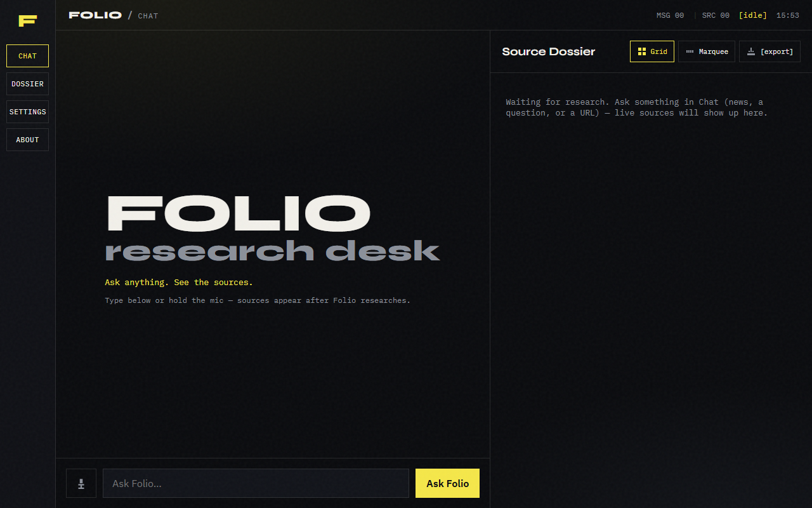
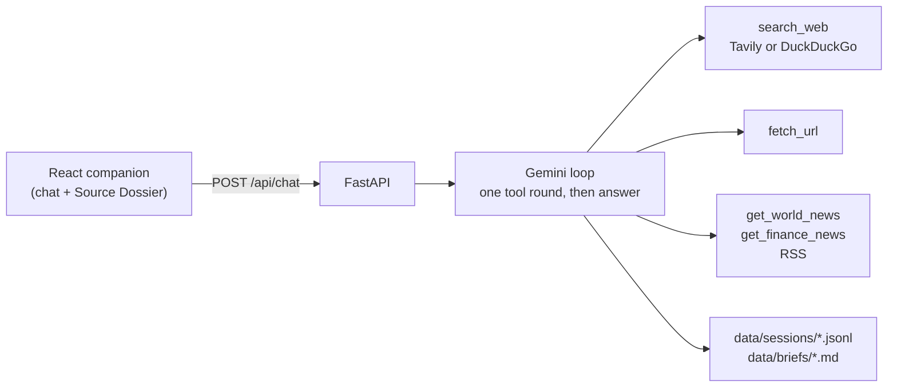

# Folio

A research desk that answers with its sources. Ask a question by text or voice:
Folio searches the web, reads pages and news feeds through Gemini tool calls, and
lists every source it used in a dossier next to the answer.

[](https://github.com/JamesKevinJones/folio/actions/workflows/ci.yml)

[](LICENSE)



<!-- TODO(kevin): add docs/img/folio-answer.gif, a real local run of one research question, once a Gemini key is in .env. -->

*Running locally with `uv run folio`, before the first question.*

**UI preview:** [folio-nine-gamma.vercel.app](https://folio-nine-gamma.vercel.app) hosts
the interface only. No API runs behind it, so questions asked there fail. Run Folio
locally (below) to get answers.

## Why

A chat answer about the news is only as good as the pages behind it, and most chat
UIs hide those. Folio shows each tool call as it runs and keeps the sources in a
separate pane, numbered, so you can open and check them. Once tools have run, the
next model call has its tools switched off, which forces a written answer instead
of another round of searching.

## How it works



- **Loop** (`folio/agent/loop.py`): the first Gemini call may request tools, which
  run together. Duplicate calls are dropped, and sources are deduplicated by URL and
  numbered. The second call has tools switched off and must answer in text.
- **Tools** (`folio/tools/research.py`): web search (Tavily with a key, DuckDuckGo
  without), page fetch with scripts and navigation stripped, and world and finance
  RSS feeds.
- **Voice**: the browser's Web Speech API, so no speech key is needed.
- **Briefs**: one click exports the question, answer and sources as Markdown.

## Results

No quality numbers yet. [docs/EVAL_PLAN.md](docs/EVAL_PLAN.md) defines the three to
measure first: citation coverage, source validity, and cost and latency per answer.

## Quickstart

Needs Python 3.11+, [uv](https://docs.astral.sh/uv/), Node 20+ and a free
[Google AI Studio](https://aistudio.google.com/) key.

```bash
git clone https://github.com/JamesKevinJones/folio.git && cd folio
cp .env.example .env                       # set GOOGLE_API_KEY
uv sync
cd apps/companion && npm ci && npm run build && cd ../..
uv run folio                               # http://127.0.0.1:8787
```

`.env.example` lists every optional setting (model, Tavily, data folder). For UI hot
reload, run `npm run dev` in `apps/companion` alongside `uv run folio` and open
`http://127.0.0.1:5173`.

Or with Docker, which builds the UI and runs both on one port as a non-root user:

```bash
docker build -t folio . && docker run --env-file .env -p 8787:8787 folio
```

## Tests and CI

```bash
uv sync --extra dev
uv run pytest -q          # 18 tests
uv run ruff check folio tests
```

The tests replace Gemini with a scripted client and the network with mock
transports, so they need no keys. A shared fixture points `data/` at a temp folder
and blanks every key, even if your `.env` has real ones. They cover the tool loop,
session storage, brief export, `/api/health`, page fetching and the search fallback.

[CI](.github/workflows/ci.yml) runs ruff and pytest, then typechecks and builds the
companion, on every push and pull request.

## What broke

- **The UI route could serve any file on disk.** The catch-all route that serves the
  built UI joined the request path onto the build folder without checking where it
  ended up. Paths arrive percent-decoded, so `GET /..%2F..%2F..%2F.env` returned the
  repo's `.env`, Gemini key included. It now resolves the path and refuses anything
  outside the build folder. A regression test covers it, and a probe against a real
  uvicorn server leaked `pyproject.toml` before the fix and not after.
- **Brief export could write outside `data/briefs`.** `POST /api/briefs/export` built
  the filename from the request's `session_id`, so `"../../x"` wrote a Markdown file
  of the caller's choosing elsewhere on disk. The session log a few lines above
  already sanitised the id; export now uses the same function, with a regression test.
- **Debug logging shipped.** Leftover instrumentation appended every chat to
  `debug-*.log` in the repo root. Removed.
- **CI was deleted.** The original workflow came out in `de2c384` because the push
  token lacked workflow scope, not because it failed. It's restored, with a UI build
  job added.
- **The hosted UI looked broken.** With no API behind the Vercel build, a question
  showed `Unexpected token '<'`, which is the page's own HTML parsed as JSON. It's now
  labelled as a UI preview rather than a live demo.

## Limitations

- **`fetch_url` fetches any http(s) address the model picks**, including `localhost`
  and private ranges. Fine on your own laptop; it needs a private-address block before
  Folio is hosted anywhere.
- **CORS allows every origin** and there's no auth. It's a single-user local app.
- **One tool round per question.** A research question costs two Gemini calls (one
  picks tools, one answers), and a question needing no tools costs one. It's cheap,
  but Folio can't follow a lead it finds in the first round of results. The free
  tier's daily limit caps how much you can ask.
- **Voice** needs a browser with the Web Speech API (Chrome or Edge).
- **DuckDuckGo search** has no key and can rate-limit. Set `TAVILY_API_KEY` for steadier
  results.

## Licence

[MIT](LICENSE)
