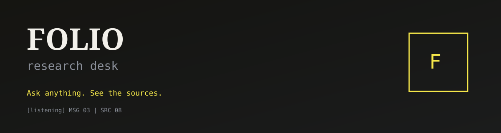

# Folio

### Ask anything. See the sources.

**Folio** is a personal research desk — not another Jarvis cosplay.  
Talk or type. Folio searches the live web, opens sources in a dossier, and keeps every claim on the record.

<p align="center">
  
</p>

---

## Why Folio

Most “AI assistants” on GitHub are glowing orbs, MCU catchphrases, and stub tools. Folio is built the other way around:

| Typical clone | Folio |
| --- | --- |
| Persona theater | Evidence-first research desk |
| Hidden tool calls | Transparent tool strip + Source Dossier |
| Invented headlines | Live search, RSS, and URL fetch |
| Paid voice APIs required | Free browser voice (Chrome / Edge) |
| Purple neon HUD | Pixel-yellow editorial UI |

**Tagline:** *Ask anything. See the sources.*

---

## Features

- **Dual-pane HUD** — Chat on the left, **Source Dossier** on the right  
- **Real research tools** — web search, URL fetch, world & finance news  
- **Citations required** — every research answer can attach clickable sources  
- **Free voice** — hold-to-talk + spoken replies via Web Speech (no OpenAI key)  
- **Brief export** — one-click Markdown of question, answer, and sources  
- **Design language** — `LOADING` splash, stacked display type, `MSG | SRC` counters, bracket states `[listening]`, Grid / Marquee dossier views  

---

## Quick start

### Prerequisites

- Python **3.11+**
- [uv](https://docs.astral.sh/uv/)
- Node **20+**
- A [Google AI Studio](https://aistudio.google.com/) key (`GOOGLE_API_KEY`)

### Install

```bash
git clone https://github.com/JamesKevinJones/folio.git
cd folio

cp .env.example .env
# set GOOGLE_API_KEY=

uv sync --extra dev
cd apps/companion && npm install && cd ../..
```

### Run (recommended)

```bash
# Terminal 1 — API + agent
uv run folio

# Terminal 2 — UI (hot reload)
cd apps/companion && npm run dev
```

Open **http://127.0.0.1:5173**

Or build the UI into the sidecar and use one URL:

```bash
cd apps/companion && npm run build && cd ../..
uv run folio
```

Open **http://127.0.0.1:8787**

---

## Environment

| Variable | Required | Purpose |
| --- | --- | --- |
| `GOOGLE_API_KEY` | Yes | Gemini chat + tools |
| `LLM_MODEL` | No | Default `gemini-flash-latest` |
| `TAVILY_API_KEY` | No | Higher-quality search |
| `OPENAI_API_KEY` | No | Legacy only (browser voice is default) |

Never commit `.env`. Use `.env.example` as the template.

---

## How it works

```text
You (text / mic)
    │
    ▼
Folio companion (React HUD)
    │  HTTP + WebSocket
    ▼
FastAPI sidecar
    │
    ├─ Gemini tool loop
    ├─ search_web / fetch_url / news RSS
    └─ session log + Markdown briefs
```

Research questions run tools, then Folio forces a **text answer** so you get sources in the dossier — not an endless tool loop.

---

## Project layout

```text
folio/
├── apps/companion/     # React HUD (Folio Design Language)
├── folio/              # FastAPI agent, tools, voice adapters
├── tests/              # pytest
├── docs/               # banner + assets
└── pyproject.toml
```

---

## Deploy

### GitHub

This repo is the source of truth. Clone, configure `.env`, run locally for the full research desk (API + tools).

### Vercel (companion UI)

The **companion** deploys as a static app on Vercel for the public face of Folio.

```bash
cd apps/companion
npx vercel --prod
```

Set `VITE_API_BASE` in the Vercel project to your running Folio API origin (for example a tunnel or cloud host of `uv run folio`). Without an API base, the hosted UI is a shell — chat needs the sidecar.

Local full stack remains the supported path for research tools.

---

## Verification

- [ ] `GET /api/health` → `llm_ready: true` when the key is set  
- [ ] “What’s happening in the world?” → headlines + dossier links  
- [ ] A factual question → live search sources (not stubs)  
- [ ] Paste a URL → fetch + cite that URL  
- [ ] Hold mic (Chrome/Edge) → transcript → spoken reply  
- [ ] Export brief → Markdown download  

```bash
uv run pytest -q
```

---

## Stack

- **UI** — React + Vite, Folio Design Language  
- **API** — FastAPI + WebSocket events  
- **LLM** — Google Gemini (`gemini-flash-latest`)  
- **Search** — DuckDuckGo (optional Tavily)  
- **Voice** — Browser Web Speech API  

---

## License

MIT — use it, fork it, cite your sources.

---

<p align="center"><b>FOLIO</b> · research desk<br/><i>Ask anything. See the sources.</i></p>
